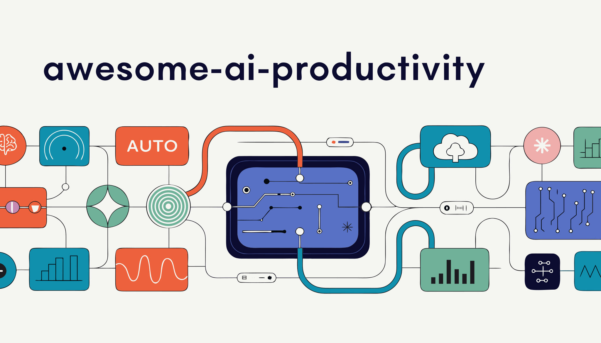

  

  

> The most comprehensive, hand-curated catalog of skills, plugins, agents, MCP servers, tools, and resources for Claude Code and Claude Cowork. Your map to the entire ecosystem — organized by what you actually need to get done.

**500+ projects** across **25 categories** — from official Anthropic tools to battle-tested community creations.

**Last updated:** March 2026

---

## How to Use This List

**If you're new to Claude Code**, start with [Official Resources](#-official-resources) and [Guides & Learning](#-guides--learning).

**If you want to extend Claude Code**, browse [Agent Skills](#-agent-skills), [Plugins](#-plugins), or [MCP Servers](#-mcp-servers).

**If you're building production systems**, see [Agent Orchestration](#-agent-orchestration--multi-agent), [Sandboxing & Security](#-sandboxing--security), and [CI/CD & GitHub Actions](#-cicd--github-actions).

**If you want a ready-made setup**, jump to [Curated Collections](#-curated-collections) for domain-specific toolkits.

---

## Contents

- [Official Resources](#-official-resources)
- [Agent Skills](#-agent-skills)
  - [Official Anthropic Skills](#official-anthropic-skills)
  - [Software Engineering](#software-engineering)
  - [Security & Auditing](#security--auditing)
  - [Frontend & Design](#frontend--design)
  - [Data Science & Analytics](#data-science--analytics)
  - [DevOps & Infrastructure](#devops--infrastructure)
  - [Content & Marketing](#content--marketing)
  - [Science & Research](#science--research)
  - [Domain-Specific](#domain-specific)
- [Plugins](#-plugins)
  - [Plugin Marketplaces & Collections](#plugin-marketplaces--collections)
  - [Code Quality & Testing](#code-quality--testing)
  - [Git & GitHub Workflow](#git--github-workflow)
  - [Project Management](#project-management)
  - [Security & Compliance](#security--compliance)
  - [Documentation](#documentation)
  - [Business & Growth](#business--growth)
- [Agent Orchestration & Multi-Agent](#-agent-orchestration--multi-agent)
- [MCP Servers](#-mcp-servers)
  - [Official MCP Servers](#official-mcp-servers)
  - [Databases](#databases)
  - [Cloud & Infrastructure](#cloud--infrastructure)
  - [Communication & Productivity](#communication--productivity)
  - [Development Tools](#development-tools)
  - [Search & Knowledge](#search--knowledge)
- [CLI Tools & Utilities](#-cli-tools--utilities)
  - [Session Management](#session-management)
  - [Configuration Management](#configuration-management)
  - [Usage Monitoring & Observability](#usage-monitoring--observability)
  - [Statuslines](#statuslines)
- [IDE Integrations](#-ide-integrations)
- [Hooks & Automation](#-hooks--automation)
- [Sandboxing & Security](#-sandboxing--security)
- [SDKs & Frameworks](#-sdks--frameworks)
- [CI/CD & GitHub Actions](#-cicd--github-actions)
- [CLAUDE.md Templates & Config](#-claudemd-templates--config)
- [Guides & Learning](#-guides--learning)
- [Curated Collections](#-curated-collections)
- [Contributing](#contributing)

---

## Official Resources

> Core tools, SDKs, and documentation maintained by Anthropic.

| Project | Description |
|---------|-------------|
| [claude-code](https://github.com/anthropics/claude-code) | The agentic coding tool that lives in your terminal. Understands your codebase, executes tasks, handles git workflows through natural language. |
| [skills](https://github.com/anthropics/skills) | Official Agent Skills repository — document manipulation, creative tools, web builders, and the skill-creator meta-skill. |
| [claude-agent-sdk-python](https://github.com/anthropics/claude-agent-sdk-python) | Official Python SDK for building autonomous agents with the same tools and agent loop that power Claude Code. |
| [claude-agent-sdk-typescript](https://github.com/anthropics/claude-agent-sdk-typescript) | Official TypeScript SDK — programmatically build AI agents that read files, run commands, search the web, and edit code. |
| [claude-agent-sdk-demos](https://github.com/anthropics/claude-agent-sdk-demos) | Multi-agent research system demos — coordinated subagents for research and report generation. |
| [knowledge-work-plugins](https://github.com/anthropics/knowledge-work-plugins) | Official plugins for knowledge workers, designed for Claude Cowork. |
| [claude-code-security-review](https://github.com/anthropics/claude-code-security-review) | Official GitHub Action for automated security reviews on pull requests. |
| [claude-quickstarts](https://github.com/anthropics/claude-quickstarts) | Quickstart templates including the computer-use demo, agentic sampling loops, and tool implementations. |
| [Claude Code Docs](https://code.claude.com/docs) | Official documentation — plugins, skills, hooks, sandboxing, IDE integration, and more. |
| [Claude API Docs](https://platform.claude.com/docs) | API reference including Agent SDK, tool use, streaming, and function calling. |

---

## Agent Skills

> Skills are folders of instructions and scripts that Claude loads dynamically to improve performance on specialized tasks. Each contains a `SKILL.md` with YAML frontmatter.

### Official Anthropic Skills

| Skill | Description |
|-------|-------------|
| [docx](https://github.com/anthropics/skills/tree/main/skills/docx) | Create, edit, and analyze Word documents with tracked changes support. |
| [pdf](https://github.com/anthropics/skills/tree/main/skills/pdf) | Comprehensive PDF manipulation — text extraction, table parsing, and metadata handling. |
| [pptx](https://github.com/anthropics/skills/tree/main/skills/pptx) | Create, edit, and analyze PowerPoint presentations with slide-level control. |
| [xlsx](https://github.com/anthropics/skills/tree/main/skills/xlsx) | Create, edit, and analyze Excel spreadsheets with formula support. |
| [algorithmic-art](https://github.com/anthropics/skills/tree/main/skills/algorithmic-art) | Generative art using p5.js with seeded randomness, particle systems, and mathematical beauty. |
| [canvas-design](https://github.com/anthropics/skills/tree/main/skills/canvas-design) | Visual art creation in PNG/PDF using design philosophies and creative direction. |
| [frontend-design](https://github.com/anthropics/skills/blob/main/skills/frontend-design) | Escape generic AI aesthetics — opinionated frontend design for React & Tailwind projects. |
| [web-artifacts-builder](https://github.com/anthropics/skills/tree/main/skills/web-artifacts-builder) | Build complex HTML artifacts with React, Tailwind CSS, and shadcn/ui. |
| [mcp-builder](https://github.com/anthropics/skills/tree/main/skills/mcp-builder) | Guidance for creating high-quality MCP servers that integrate external APIs. |
| [webapp-testing](https://github.com/anthropics/skills/tree/main/skills/webapp-testing) | Test local web applications using Playwright for automated UI verification. |
| [brand-guidelines](https://github.com/anthropics/skills/tree/main/skills/brand-guidelines) | Apply official brand colors, typography, and visual identity to artifacts. |
| [internal-comms](https://github.com/anthropics/skills/tree/main/skills/internal-comms) | Write status reports, newsletters, and internal communications with consistent voice. |
| [slack-gif-creator](https://github.com/anthropics/skills/tree/main/skills/slack-gif-creator) | Create animated GIFs optimized for Slack's size constraints and display. |
| [skill-creator](https://github.com/anthropics/skills/tree/main/skills/skill-creator) | Meta-skill — interactive Q&A that guides you through building new skills from scratch. |

### Software Engineering

| Project | Description |
|---------|-------------|
| [superpowers](https://github.com/obra/superpowers) | Core software engineering competency library covering the full SDLC — architecture, testing, debugging, refactoring. The gold standard for engineering skills. |
| [superpowers-lab](https://github.com/obra/superpowers-lab) | Experimental skills using cutting-edge techniques still being refined. Bleeding edge of what's possible. |
| [claude-skills (jeffallan)](https://github.com/jeffallan/claude-skills) | 65+ specialized skills across frameworks with Jira/Confluence integration for enterprise dev teams. |
| [claude-skills (alirezarezvani)](https://github.com/alirezarezvani/claude-skills) | 180+ production-ready skills for Claude Code and OpenAI Codex — engineering, marketing, product, compliance. |
| [code-review-expert](https://github.com/sanyuan-skills/code-review-expert) | Comprehensive code review skill that catches bugs, security issues, and architectural problems. |
| [Agent-Skills-for-Context-Engineering](https://github.com/anthropics/Agent-Skills-for-Context-Engineering) | Official context engineering skills — teach Claude to manage its own context window effectively. |
| [planning-with-files](https://github.com/anthropics/planning-with-files) | Persistent markdown-based planning — Claude creates and maintains plan files across sessions. |
| [playwright-skill](https://github.com/lackeyjb/playwright-skill) | General-purpose browser automation using Playwright for testing, scraping, and interaction. |
| [vue-skills](https://github.com/hyf0/vue-skills) | Vue 3 development assistance — Composition API, reactive patterns, and component architecture. |
| [nuxt-skills](https://github.com/nuxt/nuxt-skills) | Vue/Nuxt development skills for server-side rendering, routing, and full-stack Nuxt apps. |
| [next-skills](https://github.com/next-skills/next-skills) | Next.js workflow skills — App Router, Server Components, data fetching patterns. |
| [rust-skills](https://github.com/rust-skills/rust-skills) | Rust development assistance — ownership, lifetimes, async, and idiomatic patterns. |
| [solid-skills](https://github.com/solid-skills/solid-skills) | Senior-engineer code quality standards — SOLID principles, clean architecture, DDD. |
| [Expo-Skills](https://github.com/expo/skills) | Official Expo team skills for React Native and EAS (Expo Application Services) development. |
| [callstackincubator](https://github.com/callstackincubator/react-native-skills) | React Native skills from the Callstack team — navigation, performance, native modules. |
| [ios-simulator-skill](https://github.com/conorluddy/ios-simulator-skill) | Build, deploy, navigate, and test iOS apps through automated simulator interaction. |
| [skill-codex](https://github.com/skills-directory/skill-codex) | Delegate work to OpenAI Codex with inferred parameters and seamless session continuation. |

### Security & Auditing

| Project | Description |
|---------|-------------|
| [Trail of Bits Skills](https://github.com/trailofbits/skills) | 12+ security-focused skills from the world's leading security research firm. CodeQL, Semgrep, smart contract auditing, vulnerability detection. |
| [Trail of Bits Config](https://github.com/trailofbits/claude-code-config) | Opinionated defaults for security audits — sandboxing, permissions, hooks, and usage patterns proven in real engagements. |
| [VibeSec-Skill](https://github.com/VibeSec-Skill/VibeSec-Skill) | Security-first code writing — OWASP Top 10 prevention, input validation, and secure defaults baked into every output. |
| [awesome-dfir-skills](https://github.com/awesome-dfir-skills/awesome-dfir-skills) | Digital Forensics and Incident Response practitioner skills — log analysis, memory forensics, timeline reconstruction. |

### Frontend & Design

| Project | Description |
|---------|-------------|
| [ui-ux-pro-max-skill](https://github.com/ui-ux-pro-max-skill/ui-ux-pro-max-skill) | Design intelligence skill — Claude becomes a senior UI/UX designer with systematic design thinking. |
| [ui-skills](https://github.com/ui-skills/ui-skills) | Interface polishing skills — spacing, alignment, color harmony, responsive breakpoints. |
| [claude-design-engineer](https://github.com/claude-design-engineer/claude-design-engineer) | Design consistency tool — maintains design tokens, component libraries, and visual coherence. |
| [frontend-slides](https://github.com/zarazhangrui/frontend-slides) | Create animation-rich HTML presentations from scratch or convert from PowerPoint. |
| [Pretty-mermaid-skills](https://github.com/Pretty-mermaid-skills/Pretty-mermaid-skills) | Beautiful Mermaid chart rendering — diagrams that actually look professional. |
| [threejs-skills](https://github.com/threejs-skills/threejs-skills) | 3D element creation with Three.js — scenes, lighting, animation, and interactive experiences. |
| [visual-explainer](https://github.com/visual-explainer/visual-explainer) | HTML visual diff templates — explain code changes with before/after visualizations. |
| [manim_skill](https://github.com/manim_skill/manim_skill) | Create 3Blue1Brown-style mathematical animations using the Manim library. |
| [claude-d3js-skill](https://github.com/chrisvoncsefalvay/claude-d3js-skill) | Data visualizations in D3.js — charts, graphs, and interactive data stories. |

### Data Science & Analytics

| Project | Description |
|---------|-------------|
| [csv-data-summarizer-claude-skill](https://github.com/csv-data-summarizer/csv-data-summarizer-claude-skill) | CSV analysis skill — statistical summaries, pattern detection, anomaly identification. |
| [AI-research-SKILLs](https://github.com/AI-research-SKILLs/AI-research-SKILLs) | Visual diagram generation for research — architecture diagrams, data flow, and system design. |

### DevOps & Infrastructure

| Project | Description |
|---------|-------------|
| [cc-devops-skills](https://github.com/akin-ozer/cc-devops-skills) | DevOps-focused skills with infrastructure-as-code validation, Terraform generators, and CI/CD templates. |
| [aws-agent-skills](https://github.com/aws-agent-skills/aws-agent-skills) | AWS cloud engineering — CDK patterns, Lambda functions, ECS deployments, IAM policies. |
| [cloudflare-skill](https://github.com/cloudflare-skill/cloudflare-skill) | Cloudflare platform reference — Workers, Pages, D1, R2, and edge computing patterns. |

### Content & Marketing

| Project | Description |
|---------|-------------|
| [marketingskills](https://github.com/marketingskills/marketingskills) | Marketing and growth skills — copywriting, SEO, A/B testing, conversion optimization. |
| [claude-seo](https://github.com/claude-seo/claude-seo) | Universal SEO analysis — keyword research, content optimization, technical audits. |
| [humanizer](https://github.com/humanizer/humanizer) | AI writing humanization — make Claude's output sound natural and bypass AI detectors. |
| [x-research-skill](https://github.com/x-research-skill/x-research-skill) | X/Twitter research skill — trend analysis, sentiment tracking, audience insights. |
| [x-article-publisher-skill](https://github.com/x-article-publisher-skill/x-article-publisher-skill) | Publish long-form articles to X/Twitter with formatting and media optimization. |
| [last30days-skill](https://github.com/last30days-skill/last30days-skill) | Reddit and X research — aggregate last 30 days of discussions on any topic. |
| [Youtube-clipper-skill](https://github.com/Youtube-clipper-skill/Youtube-clipper-skill) | Video processing automation — clip extraction, transcription, highlight compilation. |

### Science & Research

| Project | Description |
|---------|-------------|
| [claude-scientific-skills](https://github.com/K-Dense-AI/claude-scientific-skills) | Comprehensive scientific domain skills — research methodology, statistical analysis, lab protocols, finance. |
| [notebooklm-skill](https://github.com/notebooklm-skill/notebooklm-skill) | NotebookLM integration — create and interact with Google's research notebook system. |
| [claude-mountaineering-skills](https://github.com/dreamiurg/claude-mountaineering-skills) | Automated mountain route research — aggregates 10+ mountaineering data sources for expedition planning. |

### Domain-Specific

| Project | Description |
|---------|-------------|
| [obsidian-skills](https://github.com/obsidian-skills/obsidian-skills) | Obsidian vault integration — note linking, graph analysis, template management. |
| [n8n-skills](https://github.com/n8n-skills/n8n-skills) | n8n workflow building — node creation, workflow optimization, API integration patterns. |
| [claude-skill-homeassistant](https://github.com/claude-skill-homeassistant/claude-skill-homeassistant) | Home Assistant management — device control, automation creation, dashboard configuration. |
| [claude-office-skills](https://github.com/claude-office-skills/claude-office-skills) | Office document creation — reports, memos, presentations with enterprise formatting. |
| [solana-dev-skill](https://github.com/solana-dev-skill/solana-dev-skill) | Solana blockchain development — smart contracts, token programs, DeFi patterns. |
| [nano-image-generator-skill](https://github.com/nano-image-generator-skill/nano-image-generator-skill) | Gemini-powered image generation — create images through Claude using Google's API. |
| [pm-skills](https://github.com/phuryn/pm-skills) | 100+ product management skills — discovery, strategy, execution, launch, and growth. |
| [Book Factory](https://github.com/robertguss/claude-skills) | Publishing pipeline — replicate traditional nonfiction book creation from outline to manuscript. |

---

## Plugins

> Plugins bundle skills, agents, hooks, and MCP servers into installable packages. Install with `claude plugin add <url>`.

### Plugin Marketplaces & Collections

| Project | Description |
|---------|-------------|
| [claude-code-plugins-plus-skills](https://github.com/jeremylongshore/claude-code-plugins-plus-skills) | 339 plugins + 1,896 agent skills with CCPI package manager, interactive tutorials, and production orchestration patterns. |
| [awesome-claude-code-plugins](https://github.com/ccplugins/awesome-claude-code-plugins) | Curated directory of 116+ plugins across 13 categories — slash commands, subagents, MCP servers, hooks. |
| [awesome-claude-plugins](https://github.com/ComposioHQ/awesome-claude-plugins) | Composio's curated plugins with adoption metrics and quality ratings. |
| [awesome-claude-plugins (quemsah)](https://github.com/quemsah/awesome-claude-plugins) | Automated plugin adoption metrics across GitHub repos using n8n workflows. |
| [CCPlugins](https://github.com/CCPlugins/CCPlugins) | Time-saving plugin collection with automated workflows and task acceleration. |
| [claude-marketplace](https://github.com/dashed/claude-marketplace) | Local marketplace for personal Claude Code skills and plugins. |
| [plugins-for-claude-natives](https://github.com/plugins-for-claude-natives) | Power user extensions for advanced Claude Code users. |

### Code Quality & Testing

| Project | Description |
|---------|-------------|
| [claude-code-safety-net](https://github.com/claude-code-safety-net/claude-code-safety-net) | Prevents destructive commands — catches `rm -rf`, force pushes, and dangerous operations before execution. |
| [tdd-guard](https://github.com/tdd-guard/tdd-guard) | TDD enforcement automation — Claude writes tests first, then implementation. Breaks the cycle of test-after. |
| [claude-review-loop](https://github.com/claude-review-loop/claude-review-loop) | Automated code review — continuous quality checks on every change with configurable rules. |
| [Compound Engineering Plugin](https://github.com/EveryInc/compound-engineering-plugin) | Pragmatic agents converting mistakes into improvement opportunities — error-driven learning. |
| [double-check](https://github.com/ccplugins/awesome-claude-code-plugins/blob/main/plugins/double-check) | Secondary verification plugin — Claude reviews its own output before presenting it. |
| [ccguard](https://github.com/ccguard/ccguard) | Code quality enforcement hooks — linting, type checking, and standards compliance. |

### Git & GitHub Workflow

| Project | Description |
|---------|-------------|
| [claude-hub](https://github.com/claude-did-this/claude-hub) | Webhook service connecting Claude Code to GitHub — autonomous issue resolution and PR creation. |
| [Continuous-Claude-v2](https://github.com/Continuous-Claude-v2) | Context management system for long-running autonomous development sessions. |
| [Continuous Claude](https://github.com/Continuous-Claude) | Autonomous PR creation — Claude watches for issues and creates fixes automatically. |
| [adversarial-spec](https://github.com/adversarial-spec) | Specification refinement through adversarial questioning — finds edge cases before code is written. |

### Project Management

| Project | Description |
|---------|-------------|
| [ccpm](https://github.com/automazeio/ccpm) | Comprehensive project-management workflow with specialized agents for planning, execution, and tracking. |
| [claude-simone](https://github.com/Helmi/claude-simone) | Broader project management with documents, guidelines, processes, and team coordination. |
| [Claude Task Master](https://github.com/eyaltoledano/claude-task-master) | Task management system for AI-driven development — priorities, dependencies, and progress tracking. |

### Security & Compliance

| Project | Description |
|---------|-------------|
| [parry](https://github.com/vaporif/parry) | Prompt injection scanner for Claude Code hooks — detect and block injection attempts in real-time. |
| [audit plugin (ccplugins)](https://github.com/ccplugins/awesome-claude-code-plugins/blob/main/plugins/audit) | Security audit automation — vulnerability scanning, dependency analysis, OWASP compliance. |
| [data-privacy-engineer](https://github.com/ccplugins/awesome-claude-code-plugins/blob/main/plugins/data-privacy-engineer) | GDPR/CCPA compliance automation — data flow mapping, consent management, privacy impact assessments. |

### Documentation

| Project | Description |
|---------|-------------|
| [context7-docs-fetcher](https://github.com/ccplugins/awesome-claude-code-plugins/blob/main/plugins/context7-docs-fetcher) | Fetch up-to-date library documentation using Context7 — always current, never stale. |
| [openapi-expert](https://github.com/ccplugins/awesome-claude-code-plugins/blob/main/plugins/openapi-expert) | OpenAPI specification expert — generate, validate, and optimize API documentation. |
| [codebase-documenter](https://github.com/ccplugins/awesome-claude-code-plugins/blob/main/plugins/codebase-documenter) | Automated codebase documentation — architecture decisions, API references, setup guides. |

### Business & Growth

| Project | Description |
|---------|-------------|
| [open-claude-cowork](https://github.com/ComposioHQ/open-claude-cowork) | Open-source Claude Cowork with 500+ SaaS app integrations via Composio — email, CRM, project management. |
| [b2b-project-shipper](https://github.com/ccplugins/awesome-claude-code-plugins/blob/main/plugins/b2b-project-shipper) | B2B project delivery automation — scoping, milestones, client communication. |
| [growth-hacker](https://github.com/ccplugins/awesome-claude-code-plugins/blob/main/plugins/growth-hacker) | Growth engineering — experiment design, funnel optimization, retention analysis. |
| [seomachine](https://github.com/seomachine/seomachine) | SEO-optimized content workspace — keyword research, content creation, and rank tracking. |

---

## Agent Orchestration & Multi-Agent

> Frameworks for coordinating multiple Claude Code agents working in parallel.

| Project | Description |
|---------|-------------|
| [Claude Squad](https://github.com/smtg-ai/claude-squad) | Terminal app managing multiple Claude Code instances in parallel. tmux-based with visual monitoring. |
| [Claude Swarm](https://github.com/parruda/claude-swarm) | Launch Claude Code connected to a swarm of specialized agents — each with its own tools and context. |
| [Claude-Flow](https://github.com/ruvnet/claude-flow) | Enterprise AI orchestration platform with distributed swarm intelligence, RAG integration, and native Claude Code support. |
| [claude_code_agent_farm](https://github.com/Dicklesworthstone/claude_code_agent_farm) | Run 20-50 Claude Code agents simultaneously — automated bug fixing, best-practices sweeps, lock-based coordination with tmux monitoring. |
| [agent-orchestrator](https://github.com/ComposioHQ/agent-orchestrator) | Agent-agnostic orchestrator (Claude Code, Codex, Aider) — plans tasks, spawns agents, handles CI fixes and merge conflicts. |
| [Auto-Claude](https://github.com/AndyMik90/Auto-Claude) | Multi-agent framework with kanban-style UI covering the full SDLC from spec to deployment. |
| [Claude Code Flow](https://github.com/ruvnet/claude-code-flow) | Code-first orchestration layer for recursive agent cycles with checkpoint management. |
| [Claude Task Runner](https://github.com/grahama1970/claude-task-runner) | Context isolation and focused task execution — prevents agents from stepping on each other. |
| [ccswarm](https://github.com/nwiizo/ccswarm) | Rust-native multi-agent orchestration using git worktree isolation for parallel development. |
| [claude-mpm](https://github.com/bobmatnyc/claude-mpm) | Multi-Agent Project Manager — subprocess orchestration layer coordinating multiple Claude instances. |
| [claude-code-by-agents](https://github.com/baryhuang/claude-code-by-agents) | Desktop app for multi-agent orchestration — coordinate local and remote agents through @mentions. |
| [Happy Coder](https://github.com/slopus/happy) | Spawn and control multiple Claude Codes from phone or desktop — mobile-first agent management. |
| [sudocode](https://github.com/sudocode-ai/sudocode) | Lightweight agent orchestration with spec framework integration — minimal overhead, maximum coordination. |
| [TSK](https://github.com/dtormoen/tsk) | Rust CLI delegating tasks to sandboxed Docker agents — safe parallel execution with resource limits. |
| [The Agentic Startup](https://github.com/rsmdt/the-startup) | Full-company agent orchestrator — CEO, CTO, designer, and developer agents collaborating on products. |
| [crystal](https://github.com/crystal/crystal) | Parallel git worktree sessions — each agent works on an isolated branch, merges handled automatically. |
| [async-code](https://github.com/async-code/async-code) | Parallel task execution framework — fire-and-forget async workflows with result aggregation. |
| [agent-of-empires](https://github.com/agent-of-empires/agent-of-empires) | Multi-agent session manager with territory-based task allocation and conflict resolution. |
| [infinite-agentic-loop](https://github.com/infinite-agentic-loop) | Continuous autonomous development loop — Claude iterates on its own output indefinitely. |
| [multi-agent-squad](https://github.com/multi-agent-squad) | Multi-agent orchestration framework with role-based agent assignment and shared memory. |
| [container-use](https://github.com/dagger/container-use) | Development environments enabling multiple agents to work safely in isolated containers with Dagger. |

### Ralph Wiggum Technique

> The "Ralph" autonomous loop technique, cited in Anthropic documentation, for self-directed long-running tasks.

| Project | Description |
|---------|-------------|
| [Ralph for Claude Code](https://github.com/frankbria/ralph-claude-code) | Autonomous framework with intelligent exit detection and safety guardrails. |
| [ralph-orchestrator](https://github.com/mikeyobrien/ralph-orchestrator) | Robust Ralph implementation cited in Anthropic docs — production-grade autonomous loops. |
| [ralph-wiggum-bdd](https://github.com/marcindulak/ralph-wiggum-bdd) | BDD with Ralph — Behavior-Driven Development powered by autonomous agent loops. |
| [The Ralph Playbook](https://github.com/ClaytonFarr/ralph-playbook) | Detailed guide with theoretical commentary and practical guidelines for the technique. |
| [awesome-ralph](https://github.com/snwfdhmp/awesome-ralph) | Curated resources about the Ralph autonomous loop technique. |

---

## MCP Servers

> Model Context Protocol servers give Claude secure, controlled access to external tools and data sources.

### Official MCP Servers

| Server | Description |
|--------|-------------|
| [modelcontextprotocol/servers](https://github.com/modelcontextprotocol/servers) | Official reference implementations — Git, GitHub, Google Drive, PostgreSQL, Slack, and more. |
| [typescript-sdk](https://github.com/modelcontextprotocol/typescript-sdk) | Official TypeScript SDK for building MCP servers and clients. |
| [python-sdk](https://github.com/modelcontextprotocol/python-sdk) | Official Python SDK for building MCP servers and clients. |

### Databases

| Server | Description |
|--------|-------------|
| [@modelcontextprotocol/server-postgres](https://github.com/modelcontextprotocol/servers) | Read-only PostgreSQL access with schema inspection and query execution. |
| [supabase MCP](https://github.com/supabase/mcp) | Supabase integration — database queries, auth, storage, edge functions, and migrations. |
| [code-sandbox-mcp](https://github.com/Automata-Labs-team/code-sandbox-mcp) | Secure code execution in Docker containers — run untrusted code safely with resource limits. |

### Cloud & Infrastructure

| Server | Description |
|--------|-------------|
| [@modelcontextprotocol/server-github](https://www.npmjs.com/package/@modelcontextprotocol/server-github) | GitHub API integration — repository management, issues, PRs, and file operations. |
| [stt-mcp-server-linux](https://github.com/marcindulak/stt-mcp-server-linux) | Push-to-talk speech transcription for Linux — voice-to-text input for Claude Code. |
| [VoiceMode MCP](https://github.com/mbailey/voicemode) | Natural voice conversations with Claude using OpenAI-compatible speech services. |

### Communication & Productivity

| Server | Description |
|--------|-------------|
| [Google Drive MCP](https://github.com/modelcontextprotocol/servers) | Google Drive file access and search — read documents, spreadsheets, and presentations. |
| [Slack MCP](https://github.com/modelcontextprotocol/servers) | Slack channel management and messaging — read channels, send messages, search history. |

### Development Tools

| Server | Description |
|--------|-------------|
| [Context7](https://github.com/upstash/context7) | Up-to-date library documentation — never work with stale docs again. Supports 8,500+ libraries. |
| [claude-context-local](https://github.com/claude-context-local) | Local code search MCP — semantic search across your codebase without sending code to the cloud. |
| [claude-context-mode](https://github.com/claude-context-mode) | Output compression via MCP — reduce context window usage by up to 95%. |

### Security & Agent Verification

| Server | Description |
|--------|-------------|
| [TWZRD Agent Intel](https://intel.twzrd.xyz) | Trust scoring for AI agent wallets on Solana. Preflight checks, behavioral scoring, and x402 cryptographic trust receipts for multi-agent systems. Free tools for identity verification before micropayments. |

---

## CLI Tools & Utilities

> Tools that enhance the Claude Code terminal experience.

### Session Management

| Project | Description |
|---------|-------------|
| [recall](https://github.com/zippoxer/recall) | Full-text search across all your Claude Code sessions with a beautiful terminal UI. Resume any past conversation. |
| [claude-mem](https://github.com/claude-mem/claude-mem) | Automatic session memory capture — persistent cross-session knowledge that Claude remembers. |
| [Claude Session Restore](https://github.com/ZENG3LD/claude-session-restore) | Restore context from previous sessions with multi-factor data collection and smart summarization. |
| [claude-code-tools](https://github.com/pchalasani/claude-code-tools) | Session continuity with cross-agent handoff and Rust-powered search for conversation history. |
| [cc-sessions](https://github.com/GWUDCAP/cc-sessions) | Opinionated session management — start, pause, resume, and organize Claude Code development sessions. |
| [claude-sessions](https://github.com/claude-sessions) | Session tracking commands — label, filter, and navigate between work streams. |
| [ccundo](https://github.com/ccundo/ccundo) | Granular undo functionality — revert specific changes without losing everything. |
| [cc-mirror](https://github.com/cc-mirror/cc-mirror) | Run multiple isolated session variants — A/B test different approaches simultaneously. |
| [ccheckpoints](https://github.com/ccheckpoints/ccheckpoints) | Session checkpoint system — save and restore session state at any point. |
| [flashbacker](https://github.com/flashbacker/flashbacker) | State management and session replay — review what happened and restore previous states. |

### Configuration Management

| Project | Description |
|---------|-------------|
| [claude-code-templates](https://github.com/davila7/claude-code-templates) | Interactive web UI to explore and install 100+ agents, commands, settings, hooks, and MCPs. |
| [claudekit](https://github.com/carlrannaberg/claudekit) | CLI toolkit with auto-save, quality hooks, and 20+ specialized subagents — batteries included. |
| [ClaudeCTX](https://github.com/foxj77/claudectx) | Switch entire Claude Code configuration with a single command — per-project or per-task contexts. |
| [claude-rules-doctor](https://github.com/nulone/claude-rules-doctor) | CLI detecting dead rules files by checking path glob matches — keep your config clean. |
| [Rulesync](https://github.com/dyoshikawa/rulesync) | Generate configs for multiple AI coding agents (Claude, Cursor, Copilot) from a single source. |
| [ccexp](https://github.com/nyatinte/ccexp) | Interactive CLI for discovering and managing Claude Code configurations across projects. |
| [ccmate](https://github.com/ccmate/ccmate) | Configuration management with templates, sharing, and synchronization across machines. |
| [claude-starter-kit](https://github.com/serpro69/claude-starter-kit) | Starter template repo with MCP servers, skills, agents, and pre-configured tooling. |
| [meridian](https://github.com/meridian/meridian) | Zero-config modular setup — opinionated defaults that just work out of the box. |
| [claude-setup](https://github.com/claude-setup/claude-setup) | One-command configuration setup tool for new Claude Code installations. |

### Usage Monitoring & Observability

| Project | Description |
|---------|-------------|
| [ccusage](https://github.com/ryoppippi/ccusage) | CLI for analyzing Claude Code usage from local JSONL files — 5-hour billing blocks, cost tracking, dashboards. |
| [ccflare](https://github.com/snipeship/ccflare) | Web-UI usage dashboard with comprehensive metrics — visualize your Claude Code consumption. |
| [better-ccflare](https://github.com/tombii/better-ccflare) | Enhanced fork with performance improvements and Docker deployment for team usage tracking. |
| [Claude Code Usage Monitor](https://github.com/Maciek-roboblog/Claude-Code-Usage-Monitor) | Real-time terminal tool showing token consumption, burn rate, and remaining capacity. |
| [Claudex](https://github.com/kunwar-shah/claudex) | Web-based browser for exploring conversation history with full-text search and analytics. |
| [cclogviewer](https://github.com/Brads3290/cclogviewer) | View Claude Code .jsonl files in a clean HTML UI — browse sessions, search, and export. |
| [cchistory](https://github.com/eckardt/cchistory) | Shell history-like tool for Bash commands executed by Claude Code — audit trail for every action. |
| [claude-code-transcripts](https://github.com/claude-code-transcripts) | Transcript publishing — share and review complete Claude Code sessions. |
| [claude-code-log](https://github.com/claude-code-log) | JSONL to HTML conversion for readable session logs. |
| [viberank](https://github.com/sculptdotfun/viberank) | Community leaderboard for visualizing Claude Code usage statistics — gamify your coding. |
| [Vibe-Log](https://github.com/vibe-log/vibe-log-cli) | Analyzes prompts locally, provides session analysis and strategic guidance for improvement. |
| [claude-code-hooks-multi-agent-observability](https://github.com/claude-code-hooks-multi-agent-observability) | Agent monitoring — trace, log, and visualize multi-agent interactions. |
| [ClaudeUsageBar](https://github.com/ClauseUsageBar) | Mac menu bar tracker — always-visible usage stats without switching to terminal. |
| [claudecode-macmenu](https://github.com/claudecode-macmenu) | macOS menu bar notifications for Claude Code events and completion. |
| [cc-monitor-rs](https://github.com/cc-monitor-rs) | Rust-based UI monitor for real-time session tracking and resource usage. |
| [cctrace](https://github.com/cctrace/cctrace) | Session export tool — extract and share specific session segments. |

### Statuslines

| Project | Description |
|---------|-------------|
| [claude-powerline](https://github.com/Owloops/claude-powerline) | Vim-style powerline with real-time tracking, git integration, and custom themes. |
| [ccstatusline](https://github.com/sirmalloc/ccstatusline) | Highly customizable formatter — model info, token usage, cost, and git status at a glance. |
| [CCometixLine](https://github.com/Haleclipse/CCometixLine) | High-performance Rust statusline with Git tracking and usage monitoring. |
| [claudia-statusline](https://github.com/hagan/claudia-statusline) | Rust-based with persistent stats and theme support — performance without compromise. |
| [claude-code-statusline (rz1989s)](https://github.com/rz1989s/claude-code-statusline) | Enhanced 4-line statusline with themes, MCP monitoring, and prayer times. |
| [claude-code-statusline (levz0r)](https://github.com/levz0r/claude-code-statusline) | Real-time token tracking, cost calculation, and git integration. |
| [cc-statusline](https://github.com/chongdashu/cc-statusline) | Clean, informative statusline with usage and context tracking. |
| [Claude Code Tamagotchi](https://github.com/Claude-Code-Tamagotchi) | Fun statusline companion — your Claude grows and evolves as you code. |
| [tweakcc](https://github.com/Piebald-AI/tweakcc) | CLI tool to customize Claude Code styling — colors, fonts, and layout. |

---

## IDE Integrations

> Connect Claude Code to your editor for a seamless development experience.

| Project | Description |
|---------|-------------|
| [Claude Code for VS Code](https://code.claude.com/docs/en/vs-code) | Official VS Code extension — native chat panel, checkpoint-based undo, @-mention files, parallel conversations. |
| [Claude Code for JetBrains](https://plugins.jetbrains.com/plugin/27310-claude-code-beta-) | Official JetBrains plugin — IntelliJ IDEA, WebStorm, PyCharm, and all JetBrains IDEs. |
| [claudecode.nvim](https://github.com/coder/claudecode.nvim) | Neovim IDE extension implementing WebSocket-based MCP protocol — full AI-powered coding in Neovim. |
| [claude-code.nvim](https://github.com/greggh/claude-code.nvim) | Alternative Neovim integration with seamless buffer management and command palette. |
| [claude-code-ide.el](https://github.com/manzaltu/claude-code-ide.el) | Emacs integration with ediff-based suggestions and MCP tool support — Emacs users rejoice. |
| [claude-code.el](https://github.com/stevemolitor/claude-code.el) | Emacs interface for Claude Code CLI — minimalist and composable. |
| [Claudix](https://github.com/Haleclipse/Claudix) | VS Code extension with interactive chat, session management, and terminal execution. |
| [claude-code-chat](https://marketplace.visualstudio.com/items?itemName=AndrePimenta.claude-code-chat) | Elegant VS Code chat interface — lightweight and focused on conversation flow. |
| [minuet-ai.nvim](https://github.com/minuet-ai/minuet-ai.nvim) | Multi-LLM code completion in Neovim — Claude, GPT, Gemini in one plugin. |
| [opcode](https://github.com/winfunc/opcode) | GUI app and toolkit — create custom agents, manage sessions, run secure background agents. |
| [n8n-nodes-claudecode](https://github.com/n8n-nodes-claudecode) | n8n workflow integration — trigger Claude Code from n8n automations. |

---

## Hooks & Automation

> Hooks execute at specific points in Claude's agentic lifecycle — PreToolUse, PostToolUse, Stop, SessionStart, and more.

| Project | Description |
|---------|-------------|
| [Dippy](https://github.com/ldayton/Dippy) | Auto-approve safe Bash commands using AST-based parsing — smart permission management. |
| [CC Notify](https://github.com/dazuiba/CCNotify) | Desktop notifications when Claude needs input or completes a task — never miss a prompt. |
| [cchooks](https://github.com/GowayLee/cchooks) | Python SDK with clean API simplifying hook integration — build hooks in minutes. |
| [Britfix](https://github.com/Talieisin/britfix) | Converts American to British English with context-aware code handling — for Commonwealth developers. |
| [claude-code-hooks](https://github.com/claude-code-hooks) | Curated hook collection — pre-built hooks for common automation needs. |
| [rins_hooks](https://github.com/rins_hooks) | Cross-platform hooks collection — works on macOS, Linux, and Windows. |
| [claude-code-boost](https://github.com/claude-code-boost) | Hook utilities — composable building blocks for custom automation. |
| [cc-tools](https://github.com/Veraticus/cc-tools) | High-performance Go implementation of hooks and utilities — speed when it matters. |
| [peon-ping](https://github.com/peon-ping) | Warcraft-style voice notifications — "Work complete!" when Claude finishes a task. |
| [claude-island](https://github.com/claude-island) | Animal Crossing-style notification system — delightful alerts for Claude events. |
| [claude-code-voice](https://github.com/claude-code-voice) | macOS voice control — talk to Claude Code hands-free with speech-to-text. |

---

## Sandboxing & Security

> Run Claude Code safely with proper isolation, especially when using `--dangerously-skip-permissions`.

| Project | Description |
|---------|-------------|
| [Docker Sandboxes](https://www.docker.com/blog/docker-sandboxes-run-claude-code-and-other-coding-agents-unsupervised-but-safely/) | Official Docker sandboxing — the only solution allowing agents to build and run Docker containers while remaining isolated. |
| [claude-code-devcontainer](https://github.com/trailofbits/claude-code-devcontainer) | Trail of Bits sandboxed devcontainer for running Claude Code in bypass mode safely — built for security audits. |
| [claudebox](https://github.com/claudebox/claudebox) | Docker development environment — pre-configured with tools, permissions, and network isolation. |
| [run-claude-docker](https://github.com/icanhasjonas/run-claude-docker) | Self-contained Docker runner — forward workspace to isolated container with one command. |
| [viwo-cli](https://github.com/OverseedAI/viwo) | Run Claude Code in Docker with git worktrees — safe isolation with full git workflow support. |
| [claude-code-sandbox (Z7Lab)](https://github.com/Z7Lab/claude-code-sandbox) | System isolation protecting files, credentials, and system while Claude works in a container. |
| [claude-sandbox (rsh3khar)](https://github.com/rsh3khar/claude-sandbox) | Run `--dangerously-skip-permissions` safely — all the power, none of the risk. |
| [claude-code-container](https://github.com/claude-code-container) | Docker container with `dangerously` mode — isolated execution with escape hatches. |

---

## SDKs & Frameworks

> Build on top of Claude Code programmatically.

| Project | Description |
|---------|-------------|
| [SuperClaude Framework](https://github.com/SuperClaude-Org/SuperClaude_Framework) | Meta-programming configuration framework — specialized commands, cognitive personas, and development methodologies. |
| [Claude Engineer](https://github.com/Doriandarko/claude-engineer) | Interactive CLI leveraging Claude for software development — generates and manages its own tools. |
| [ContextKit](https://github.com/FlineDev/ContextKit) | Systematic framework with 4-phase planning and quality agents — structure for complex projects. |
| [claude-code-router](https://github.com/claude-code-router) | Flexible AI infrastructure — route requests across multiple Claude instances. |
| [cipher](https://github.com/cipher) | Coding agent memory layer — persistent knowledge that survives across sessions. |
| [Claudeception](https://github.com/Claudeception) | Skill extraction and learning — Claude learns new skills by analyzing other tools. |
| [claude-cognitive](https://github.com/claude-cognitive) | Working memory system — structured reasoning and chain-of-thought enhancement. |
| [claude-self-reflect](https://github.com/claude-self-reflect) | Memory persistence through self-reflection — Claude maintains its own knowledge base. |
| [Severance](https://github.com/Severance) | Semantic memory system — long-term knowledge storage with retrieval-augmented recall. |
| [context-forge](https://github.com/context-forge) | Context engineering CLI — optimize what Claude knows for maximum performance. |
| [claude-code-spec-workflow](https://github.com/claude-code-spec-workflow) | Automated spec-driven workflow — requirements to code with validation at every step. |
| [ClaudeForge](https://github.com/ClaudeForge) | CLAUDE.md generator — answer questions, get a perfectly structured CLAUDE.md. |
| [claude-modular](https://github.com/claude-modular) | Modular framework — compose Claude Code capabilities like LEGO blocks. |

---

## CI/CD & GitHub Actions

> Integrate Claude Code into your continuous integration and deployment pipelines.

| Project | Description |
|---------|-------------|
| [claude-code-action](https://github.com/anthropics/claude-code-action) | Official GitHub Action — automated PR reviews, issue resolution, and code generation in CI. |
| [claude-code-base-action](https://github.com/claude-code-base-action) | Base action for building custom Claude Code GitHub Actions. |
| [Claude-Code-Remote](https://github.com/Claude-Code-Remote) | Email-based remote control — send tasks to Claude Code via email, get results back. |

---

## CLAUDE.md Templates & Config

> Templates and best practices for configuring Claude Code with CLAUDE.md files.

| Project | Description |
|---------|-------------|
| [claude-md-templates](https://github.com/abhishekray07/claude-md-templates) | CLAUDE.md best practices — templates for global, project, and local configuration. |
| [claude-code-best-practice](https://github.com/shanraisshan/claude-code-best-practice) | Battle-tested practices for effective Claude Code usage — the "practice made perfect" approach. |
| [claude-code-ultimate-guide](https://github.com/FlorianBruniaux/claude-code-ultimate-guide) | Beginner-to-advanced guide with production templates, quizzes, and a comprehensive cheatsheet. |
| [Claude-Code-Everything-You-Need-to-Know](https://github.com/wesammustafa/Claude-Code-Everything-You-Need-to-Know) | All-in-one mastery guide — setup, prompt engineering, commands, hooks, MCP, BMAD method. |
| [claude-code-my-workflow](https://github.com/pedrohcgs/claude-code-my-workflow) | Ready-to-fork template for academics using LaTeX/Beamer + R — multi-agent review and QA. |
| [claude-code-configs](https://github.com/claude-code-configs) | Production configurations from real projects — copy what works. |
| [claude-code-settings](https://github.com/claude-code-settings) | Vibe coding configuration — optimized for flow state and creative development. |
| [claude-code-auto-memory](https://github.com/claude-code-auto-memory) | Automatic CLAUDE.md maintenance — keeps your configuration fresh and relevant. |

---

## Guides & Learning

> Documentation, tutorials, courses, and resources for mastering Claude Code.

| Resource | Description |
|----------|-------------|
| [Claude Code Docs](https://code.claude.com/docs) | Official documentation — the definitive reference for all Claude Code features. |
| [Claude Code Tips](https://github.com/ykdojo/claude-code-tips) | 35+ information-dense tips covering voice, patching, orchestration, and advanced usage. |
| [Claude Code Documentation Mirror](https://github.com/ericbuess/claude-code-docs) | Anthropic docs mirror updated every few hours — searchable and always available. |
| [Claude Code Handbook](https://nikiforovall.blog/claude-code-rules/) | Best practices, tips, and techniques with distributable plugins and configurations. |
| [Claude Code System Prompts](https://github.com/Piebald-AI/claude-code-system-prompts) | All system prompt parts updated for each Claude Code version — see how Claude thinks. |
| [Learn Claude Code](https://github.com/shareAI-lab/learn-claude-code) | Analysis of Claude Code's agent design with minimal-code reconstruction — understand the internals. |
| [Claude CodePro](https://github.com/maxritter/claude-codepro) | Professional environment with spec-driven workflow and TDD enforcement — level up your practice. |
| [RIPER Workflow](https://github.com/tony/claude-code-riper-5) | Research-Innovate-Plan-Execute-Review — structured development phases for consistent quality. |
| [AB Method](https://github.com/ayoubben18/ab-method) | Spec-driven workflow transforming large problems into focused, manageable missions. |
| [Agentic Workflow Patterns](https://github.com/ThibautMelen/agentic-workflow-patterns) | Documented patterns with Mermaid diagrams covering all major orchestration strategies. |
| [Claude Code Repos Index](https://github.com/danielrosehill/Claude-Code-Repos-Index) | Index of 75+ Claude Code repositories spanning CMS, security, health, IoT, and more. |
| [Shipping Real Code w/ Claude](https://diwank.space/field-notes-from-shipping-real-code-with-claude/) | Field notes on product shipping with CLAUDE.md — what actually works in production. |
| [learn-faster-kit](https://github.com/cheukyin175/learn-faster-kit) | Educational framework inspired by FASTER self-teaching approach — learn anything faster with Claude. |
| [Everything Claude Code](https://github.com/affaan-m/everything-claude-code) | Top-tier resources covering core engineering domains with standalone value. |
| [Skill_Seekers](https://github.com/yusufkaraaslan/Skill_Seekers) | Convert any documentation website into Claude Skills — bring external knowledge into Claude. |

### Articles & Deep Dives

| Article | Description |
|---------|-------------|
| [A Mental Model for Claude Code](https://levelup.gitconnected.com/a-mental-model-for-claude-code-skills-subagents-and-plugins-3dea9924bf05) | Skills, subagents, and plugins explained — the conceptual framework for the ecosystem. |
| [Become a Claude Code Hero](https://medium.com/@diehardankush/become-a-claude-code-hero-core-concepts-of-the-claude-cli-plugins-hooks-skills-mcp-54ae48d7c145) | Core concepts of the CLI — plugins, hooks, skills, and MCP in one place. |
| [Top 10 Claude Code Plugins (Composio)](https://composio.dev/content/top-claude-code-plugins) | Curated top picks with real-world use cases and installation guides. |
| [Claude Code Plugins Guide (Morph)](https://www.morphllm.com/claude-code-plugins) | Best plugins, installation, and build guide — comprehensive walkthrough. |
| [Equipping Agents for the Real World](https://www.anthropic.com/engineering/equipping-agents-for-the-real-world-with-agent-skills) | Anthropic's engineering blog on Agent Skills — the philosophy behind the system. |

---

## Curated Collections

> Ready-made setups for specific domains — install and immediately become more effective.

### The Security Engineer's Toolkit
For penetration testers, security auditors, and AppSec engineers:
- [Trail of Bits Skills](https://github.com/trailofbits/skills) — Security audit skills with CodeQL and Semgrep
- [Trail of Bits Config](https://github.com/trailofbits/claude-code-config) — Hardened Claude Code configuration for security work
- [VibeSec-Skill](https://github.com/VibeSec-Skill/VibeSec-Skill) — Secure-by-default code writing
- [parry](https://github.com/vaporif/parry) — Prompt injection defense
- [claude-code-devcontainer](https://github.com/trailofbits/claude-code-devcontainer) — Isolated sandbox for reviewing untrusted code
- [awesome-dfir-skills](https://github.com/awesome-dfir-skills/awesome-dfir-skills) — Digital forensics and incident response

### The Startup Founder's Arsenal
For solo founders and small teams shipping fast:
- [Claude Task Master](https://github.com/eyaltoledano/claude-task-master) — AI-driven project management
- [ccpm](https://github.com/automazeio/ccpm) — Full project management workflow
- [The Agentic Startup](https://github.com/rsmdt/the-startup) — CEO, CTO, designer, developer agents
- [b2b-project-shipper](https://github.com/ccplugins/awesome-claude-code-plugins/blob/main/plugins/b2b-project-shipper) — B2B delivery automation
- [growth-hacker](https://github.com/ccplugins/awesome-claude-code-plugins/blob/main/plugins/growth-hacker) — Growth engineering
- [seomachine](https://github.com/seomachine/seomachine) — SEO content workspace
- [open-claude-cowork](https://github.com/ComposioHQ/open-claude-cowork) — 500+ SaaS integrations

### The 10x Developer Setup
For maximum individual coding productivity:
- [superpowers](https://github.com/obra/superpowers) — Core engineering skills
- [Claude Squad](https://github.com/smtg-ai/claude-squad) — Parallel agent management
- [recall](https://github.com/zippoxer/recall) — Search and resume any session
- [claude-powerline](https://github.com/Owloops/claude-powerline) — Beautiful statusline
- [Dippy](https://github.com/ldayton/Dippy) — Auto-approve safe commands
- [ccusage](https://github.com/ryoppippi/ccusage) — Usage tracking
- [claudekit](https://github.com/carlrannaberg/claudekit) — CLI toolkit with 20+ agents
- [crystal](https://github.com/crystal/crystal) — Parallel worktree sessions

### The Frontend Artisan's Studio
For designers and frontend developers who care about pixels:
- [ui-ux-pro-max-skill](https://github.com/ui-ux-pro-max-skill/ui-ux-pro-max-skill) — Design intelligence
- [frontend-design (official)](https://github.com/anthropics/skills/blob/main/skills/frontend-design) — Anti-generic aesthetics
- [ui-skills](https://github.com/ui-skills/ui-skills) — Interface polishing
- [threejs-skills](https://github.com/threejs-skills/threejs-skills) — 3D experiences
- [vue-skills](https://github.com/hyf0/vue-skills) / [next-skills](https://github.com/next-skills/next-skills) — Framework-specific skills
- [Expo-Skills](https://github.com/expo/skills) — Mobile with React Native

### The Content Creator's Workshop
For writers, marketers, and content strategists:
- [marketingskills](https://github.com/marketingskills/marketingskills) — Full marketing toolkit
- [claude-seo](https://github.com/claude-seo/claude-seo) — SEO analysis
- [humanizer](https://github.com/humanizer/humanizer) — Natural-sounding writing
- [x-research-skill](https://github.com/x-research-skill/x-research-skill) — Social media research
- [last30days-skill](https://github.com/last30days-skill/last30days-skill) — Trend aggregation
- [Youtube-clipper-skill](https://github.com/Youtube-clipper-skill/Youtube-clipper-skill) — Video content tools
- [Book Factory](https://github.com/robertguss/claude-skills) — Nonfiction publishing pipeline

### The DevOps Command Center
For infrastructure engineers and platform teams:
- [cc-devops-skills](https://github.com/akin-ozer/cc-devops-skills) — IaC and CI/CD skills
- [aws-agent-skills](https://github.com/aws-agent-skills/aws-agent-skills) — AWS cloud engineering
- [cloudflare-skill](https://github.com/cloudflare-skill/cloudflare-skill) — Edge computing
- [claude-code-action](https://github.com/anthropics/claude-code-action) — GitHub Actions integration
- [container-use](https://github.com/dagger/container-use) — Safe agent containers with Dagger
- [claude-code-devcontainer](https://github.com/trailofbits/claude-code-devcontainer) — Isolated dev environments

### The Researcher's Lab
For scientists, academics, and data analysts:
- [claude-scientific-skills](https://github.com/K-Dense-AI/claude-scientific-skills) — Scientific domain skills
- [AI-research-SKILLs](https://github.com/AI-research-SKILLs/AI-research-SKILLs) — Visual research diagrams
- [notebooklm-skill](https://github.com/notebooklm-skill/notebooklm-skill) — NotebookLM integration
- [claude-d3js-skill](https://github.com/chrisvoncsefalvay/claude-d3js-skill) — Data visualizations
- [manim_skill](https://github.com/manim_skill/manim_skill) — Mathematical animations
- [claude-code-my-workflow](https://github.com/pedrohcgs/claude-code-my-workflow) — Academic LaTeX + R workflow
- [csv-data-summarizer-claude-skill](https://github.com/csv-data-summarizer/csv-data-summarizer-claude-skill) — Data analysis

### The Enterprise Architect's Blueprint
For teams building production systems at scale:
- [Claude-Flow](https://github.com/ruvnet/claude-flow) — Enterprise orchestration
- [claude_code_agent_farm](https://github.com/Dicklesworthstone/claude_code_agent_farm) — 50-agent parallel execution
- [tdd-guard](https://github.com/tdd-guard/tdd-guard) — TDD enforcement
- [claude-code-safety-net](https://github.com/claude-code-safety-net/claude-code-safety-net) — Destructive command prevention
- [agent-orchestrator](https://github.com/ComposioHQ/agent-orchestrator) — CI-aware orchestration
- [Trail of Bits Config](https://github.com/trailofbits/claude-code-config) — Security-hardened configuration
- [claude-code-hooks-multi-agent-observability](https://github.com/claude-code-hooks-multi-agent-observability) — Agent monitoring

---

## Contributing

Contributions are welcome. Please ensure your addition:

1. **Is actively maintained** — last commit within 6 months
2. **Solves a real problem** — not a toy project or duplicate of existing tools
3. **Has documentation** — README with installation and usage instructions
4. **Works with current Claude Code** — compatible with the latest version

To add a project, open a PR with your addition in the appropriate category. Include the project name, URL, and a concise description of what it does and why it matters.

---

  Built with Claude Code. Curated by humans who care about developer tools.

